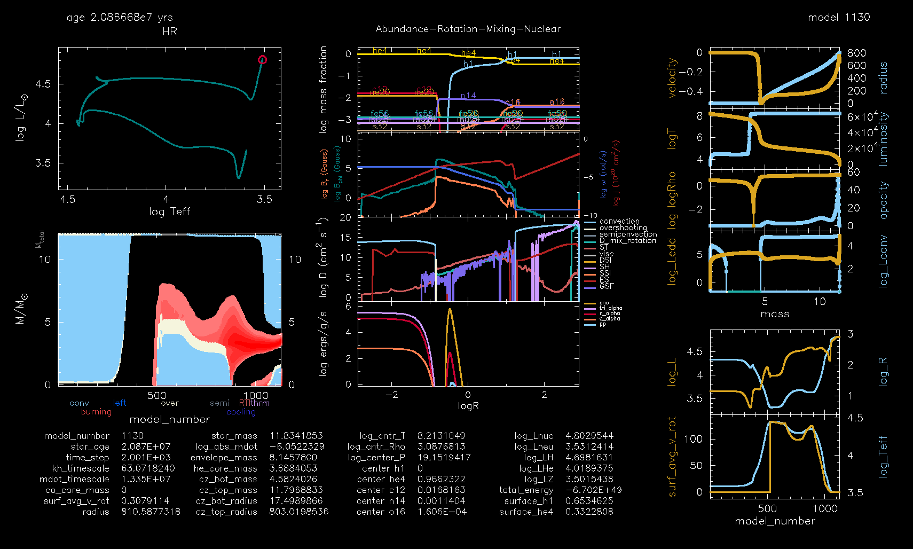

#+title: $12M_{\odot}$ from pre-MS to onset of core-collapse
#+author: Mathieu Renzo w/ Claude:Opus 5

#+CAPTION: Snapshot
#+DOWNLOADED: screenshot @ 2026-10-24 19:01:22

** Technical info

Based on =$MESA_DIR/star/test_suite/12M_pre_ms_to_core_collapse=.

- MESA version: =r15140-3100-g9f9a2afc8=
- MESASDK: =x86_64-linux-26.6.1=

Compile and run: =make && ./rn=, then use the =images_to_movie= script shipped with the SDK.

#+BEGIN_SRC bash
  gfotran --version
  GNU Fortran (GCC) 15.2.0
  Copyright (C) 2025 Free Software Foundation, Inc.
  This is free software; see the source for copying conditions.  There is NO
  warranty; not even for MERCHANTABILITY or FITNESS FOR A PARTICULAR PURPOSE.
#+END_SRC
