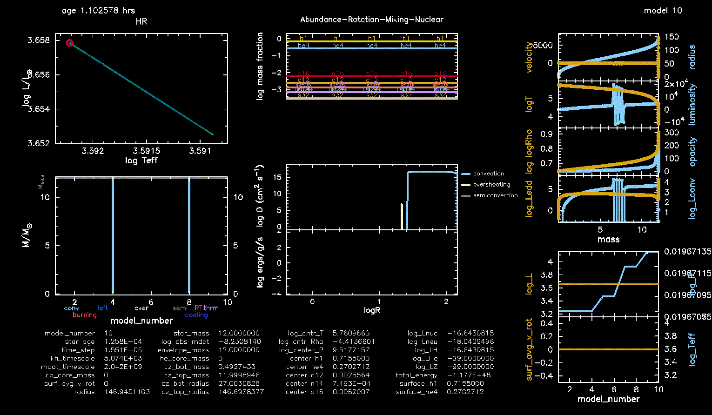

#+title: 12M_{\odot} from pre-MS to onset of core-collapse
#+author: Mathieu Renzo w/ Claude:Opus 5

Setup to create [[./demo_12Msun.mp4][demo video of a 12M_{\odot} mildly-rotating star]].

#+CAPTION: Animated gif of the entire evolution.

Rotation is initialized at zero age main sequence. Only then the
corresponding panels appear in the plots. =pgstar= is highly
configurable and many other parameters can be shown and/or calculated
by =MESA=, see [[https://docs.mesastar.org/en/26.4.1/reference/pgstar.html][the docs]].

** Technical info

Based on =$MESA_DIR/star/test_suite/12M_pre_ms_to_core_collapse=, adding
initial rotation with $\omega=0.2\omega_{crit}$ at zero age main sequence.

- MESA version: =r15140-3100-g9f9a2afc8= (not a release version)
- MESASDK: =x86_64-linux-26.6.1=

Compile and run: =make && ./rn=, then use the =images_to_movie= script shipped with the SDK.

#+BEGIN_SRC bash
  gfotran --version
  GNU Fortran (GCC) 15.2.0
  Copyright (C) 2025 Free Software Foundation, Inc.
  This is free software; see the source for copying conditions.  There is NO
  warranty; not even for MERCHANTABILITY or FITNESS FOR A PARTICULAR PURPOSE.
#+END_SRC
